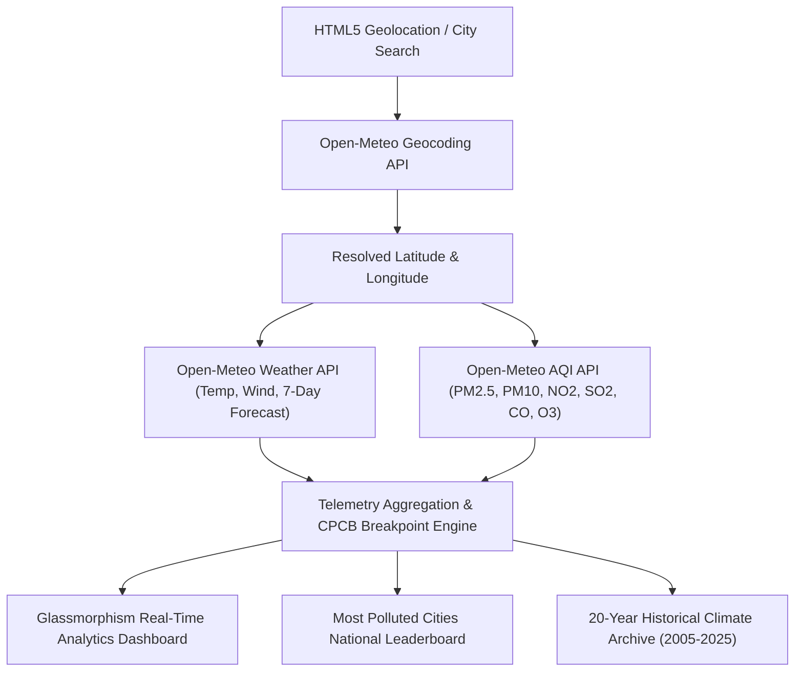

# VayuWeather — Real-Time Weather & Air Quality Analytics Platform

[](https://www.python.org/)
[](#)
[](https://streamlit.io/)
[-indigo.svg)](#)
[](LICENSE)

An enterprise-grade meteorological and atmospheric telemetry platform integrating **live Open-Meteo REST APIs, HTML5 real-time geolocation, a 7-day weather predictor, continuous chemical pollutant meters, a national most-polluted cities leaderboard, and a 20-year multi-decade historical archive (2005–2025)**.

Engineered as part of the **Industrial Training & Final Project (Subject Code: NBCA 308P)** at **City College of Management, Lucknow**, under the domain *Python with Data Analytics* at **Analyze InfoTech** by **Mohd Ajmal** (Roll No: 2511755060060) under the supervision of **Mr. Danish Khan**.

---

## 🌟 Core System Specifications (9-Point Implementation)

1. **Real-Time Weather & Air Quality API Engine**:
   - Queries real-time Open-Meteo APIs (`api.open-meteo.com` and `air-quality-api.open-meteo.com`) without API keys, CORS issues, or rate limiting.
   - Provides live ambient temperatures, apparent ("feels like") temperatures, relative humidity, surface wind velocity, and UV index.

2. **Real-Time GPS Location Detection**:
   - One-click **"Use My Live Location"** utilizes HTML5 Geolocation API (`navigator.geolocation`) and Open-Meteo reverse geocoding to automatically stream live weather and AQI for the user's exact coordinates.

3. **Global & Municipal Location Search**:
   - High-speed location search bar with automated geocoding allows searching for **any city or place in India and globally** (e.g. Lucknow, Delhi, Mumbai, Kanpur, Varanasi, London, New York).

4. **7-Day Numerical Weather Predictor**:
   - 7-day forecast cards displaying maximum/minimum temperatures, precipitation sum (mm), wind dynamics, weather icons, and projected daily AQI categories.
   - Interactive dual-axis chart tracking temperature curves alongside projected air quality.

5. **Real-Time AQI Condition & Health Advisory**:
   - Prominent real-time AQI meter (0–500 scale) with color-coded CPCB severity tiers (**Good, Satisfactory, Moderate, Poor, Very Poor, Severe**).
   - Dynamic clinical health advisories (e.g. N95 mask requirements, outdoor exertion warnings).

6. **Real-Time Pollutant Concentration Profile**:
   - Telemetry breakdown cards with visual limit progress bars for:
     - **PM 2.5** (Fine Respirable Dust, µg/m³)
     - **PM 10** (Coarse Inhalable Particles, µg/m³)
     - **NO₂** (Nitrogen Dioxide, µg/m³)
     - **SO₂** (Sulfur Dioxide, µg/m³)
     - **CO** (Carbon Monoxide, mg/m³)
     - **O₃** (Ground-Level Ozone, µg/m³)

7. **Executive Glassmorphism Dashboard**:
   - Modern, high-contrast dark theme dashboard with responsive layout, KPI metric cards, and Chart.js / Plotly interactive visualizations.

8. **India's Most Polluted Cities Live Leaderboard**:
   - Ranked national monitoring table of the most polluted regions across India (Delhi, Ghaziabad, Noida, Faridabad, Lucknow, Kanpur, Patna, etc.).
   - Displays real-time AQI, current weather, temperature, primary offending pollutant, and one-click **"Load Live"** inspection.

9. **20-Year Historical AQI Archive (2005 - 2025)**:
   - Longitudinal multi-decade archive featuring annual mean AQI, peak winter smog crisis levels (e.g. Nov 2016 peak at 488 AQI), the unprecedented April 2020 COVID-19 lockdown drop (-58%), and recent EV/BS-VI transition impacts.

---

## 🏗️ Telemetry & Analytics Architecture



---

## 🔑 Access Configuration & Monitored Hubs

> [!NOTE]
> **Open Atmospheric Research Platform**: Designed as a public environmental telemetry station. No authentication or login password is required to access live Open-Meteo weather APIs, 7-day numerical predictors, pollutant breakdown meters, or the 20-year historical climate archive.

| Access Role | Authentication | Permitted Operations |
| :--- | :--- | :--- |
| **Public Citizen / Analyst** | Open Access (No Login) | Real-time GPS detection, worldwide city search, 7-day forecasts, pollutant gauges, 20-year archive |
| **Default Station** | Automatic GPS / Lucknow | Coordinates: `26.8467° N, 80.9462° E` (City College of Management baseline) |
| **Pre-Configured City Queries** | One-Click Fast Inspection | Lucknow, New Delhi, Mumbai, Kanpur, Varanasi, Bengaluru, London, New York |

---

## 🖥️ Standalone Browser Demo & Quick Execution

- **Instant Zero-Dependency Browser App**: Open `index.html` directly in any web browser.
- **Direct File Path**: [index.html](file:///C:/Users/KRIN/.gemini/antigravity/scratch/04-weather-aqi-analytics/index.html)

---

## 📊 CPCB Air Quality Index Breakpoints

| AQI Category | Scale | $PM_{2.5}$ ($\mu g/m^3$) | $PM_{10}$ ($\mu g/m^3$) | Health Impact Statement |
| :--- | :--- | :--- | :--- | :--- |
| **Good** | 0 – 50 | 0 – 30 | 0 – 50 | Minimal health impact; pristine clean air. |
| **Satisfactory**| 51 – 100 | 31 – 60 | 51 – 100 | Minor breathing discomfort to sensitive individuals. |
| **Moderate** | 101 – 200 | 61 – 90 | 101 – 250 | Breathing discomfort to people with asthma/heart ailments. |
| **Poor** | 201 – 300 | 91 – 120 | 251 – 350 | Breathing discomfort to most people on prolonged exposure. |
| **Very Poor** | 301 – 400 | 121 – 250 | 351 – 430 | Respiratory illness on prolonged exposure. |
| **Severe** | 401 – 500 | 250+ | 430+ | Serious health impacts on healthy individuals; hazardous. |

---

## 🚀 Running the Streamlit App

```bash
cd C:/Users/KRIN/.gemini/antigravity/scratch/04-weather-aqi-analytics

# 1. Install dependencies
pip install -r requirements.txt

# 2. Launch the Streamlit dashboard
streamlit run app.py
```
Visit `http://localhost:8501` in your web browser.

---

## 💡 Key Technical Viva / Interview Q&A

1. **Why was Open-Meteo chosen instead of OpenWeatherMap or AQICN?**
   * *Answer*: Open-Meteo provides free open-access meteorological data derived directly from national weather services (DWD, NOAA, ECMWF) without API keys, restrictive rate limits, or billing requirements, ideal for non-profit research and education platforms.
2. **How is the Air Quality Index (AQI) mathematically computed from raw pollutant values?**
   * *Answer*: Following the Central Pollution Control Board (CPCB) linear interpolation sub-index formula:
     $$I_p = \frac{I_{hi} - I_{lo}}{B_{hi} - B_{lo}} \times (C_p - B_{lo}) + I_{lo}$$
     The overall AQI represents the maximum sub-index among all monitored pollutants ($AQI = \max(I_1, I_2, \dots, I_n)$).
3. **What is the significance of the 20-Year Historical AQI Archive?**
   * *Answer*: It provides longitudinal epidemiological context, demonstrating long-term environmental patterns including the 2016 winter smog crisis, seasonal crop residue (stubble) burning spikes, and the 58% AQI drop recorded during the 2020 national lockdowns.
4. **How does client-side geolocation work securely?**
   * *Answer*: Through `navigator.geolocation.getCurrentPosition()`. The browser prompts the user for explicit location permission, retrieves latitude and longitude coordinates, and queries reverse-geocoding endpoints to display weather without storing user tracking data.
5. **How are real-time pollutants monitored?**
   * *Answer*: By decomposing atmospheric chemical measurements into six primary criteria pollutants ($PM_{2.5}, PM_{10}, NO_2, SO_2, CO, O_3$), evaluated against national ambient air quality standards (NAAQS).

---

## 📄 License & Attribution
Designed and engineered by **Mohd Ajmal** (BCA 3rd Sem, Roll No. 2511755060060) under the supervision of **Mr. Danish Khan**, Assistant Professor, City College of Management, Lucknow.
Licensed under the [MIT License](LICENSE).
